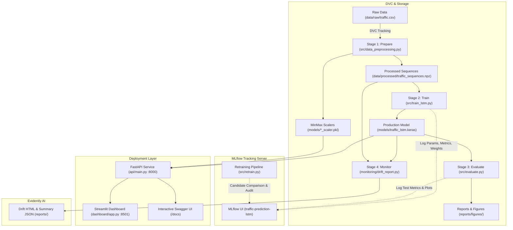

# AI-Based Traffic Prediction System with MLOps

[](https://www.python.org/)
[](https://www.tensorflow.org/)
[](https://fastapi.tiangolo.com/)
[](https://streamlit.io/)
[](https://mlflow.org/)
[](https://dvc.org/)
[](https://evidentlyai.com/)
[](https://www.docker.com/)
[]()

A production-ready, reproducible Machine Learning Operations (MLOps) system for hourly traffic volume forecasting across multi-junction road networks. Built with Deep LSTM networks, FastAPI model serving, a Streamlit interactive dashboard, MLflow experiment tracking, DVC pipeline versioning, Evidently AI drift monitoring, and a safe candidate-model retraining workflow.

---

## 📌 Project Overview

Urban vehicular congestion leads to severe delays, elevated emissions, and fuel wastage. Accurate short-term traffic volume forecasting enables municipal traffic management authorities and intelligent transportation systems (ITS) to dynamically optimize signal timings and divert traffic proactively.

### Key Capabilities (Phase 1 & Phase 2 Complete)
1. **Time-Series Deep Learning**: 2-layer Long Short-Term Memory (LSTM) network with Dropout and Dense output.
2. **Strict Chronological Sequencing**: 24-step sliding window ($T=24$ hours lookback) with zero future data leakage.
3. **RESTful Model Serving**: High-performance **FastAPI** service with `/health`, `/model-info`, `/predict`, and `/junctions` endpoints.
4. **Interactive Dashboard**: Modern **Streamlit** UI supporting historical evaluation, multi-step future forecasting, and session tracking.
5. **Experiment Tracking**: **MLflow** recording parameters, epoch loss curves, evaluation metrics, and model artifacts.
6. **Data & Pipeline Versioning**: **DVC** tracking raw data and reproducible DAG pipeline stages (`prepare` $\rightarrow$ `train` $\rightarrow$ `evaluate` $\rightarrow$ `monitor`).
7. **Production Data Drift Monitoring**: **Evidently AI** comparing reference training distributions with incoming test horizons and tracking model performance drift.
8. **Safe Candidate Retraining**: Controlled retraining workflow comparing candidate RMSE/$R^2$ against production baseline with automatic promotion gates and backups.
9. **Automated Unit & Integration Testing**: Comprehensive **pytest** suite validating schemas, endpoints, and transforms.

---

## 🏗️ System Architecture



---

## 📊 Dataset & Feature Engineering

- **Dataset**: Traffic Prediction Dataset (Hourly Vehicle Counts Across 4 Junctions)
- **Kaggle Source**: [https://www.kaggle.com/datasets/fedesoriano/traffic-prediction-dataset](https://www.kaggle.com/datasets/fedesoriano/traffic-prediction-dataset)
- **Observations**: `48,120` rows $\times$ `4` raw columns
- **Timestamp Coverage**: `2015-11-01 00:00:00` to `2017-06-30 23:00:00`
- **Target Variable**: `Vehicles` (hourly count)

### Input Feature Matrix ($T=24$ Steps $\times 6$ Features)
| Feature Name | Type | Description |
| :--- | :--- | :--- |
| **`Vehicles`** | Float | Scaled vehicle count from preceding observation |
| **`Hour`** | Integer ($0$–$23$) | Diurnal cycle (morning/evening rush hour identifier) |
| **`DayOfWeek`** | Integer ($0$–$6$) | Day of week ($0 = \text{Monday}, \dots, 6 = \text{Sunday}$) |
| **`Month`** | Integer ($1$–$12$) | Seasonal calendar month |
| **`IsWeekend`** | Binary ($0/1$) | Weekend traffic shift indicator |
| **`Junction`** | Integer ($1$–$4$) | Specific junction identifier |

### Chronological Holdout Split (Strictly No Random Shuffling)
- **Training Set (70.0%)**: `33,684` samples (`2015-11-01 00:00:00` to `2017-01-31 14:00:00`)
- **Validation Set (15.0%)**: `7,218` samples (`2017-01-31 15:00:00` to `2017-04-16 19:00:00`)
- **Testing Set (15.0%)**: `7,218` samples (`2017-04-16 19:00:00` to `2017-06-30 23:00:00`)

---

## 🧠 LSTM Neural Network Specification

```text
Input Layer (Shape: [Batch Size, 24 Steps, 6 Features])
       │
       ▼
LSTM Layer 1 (64 Units, return_sequences=True, name="lstm_layer_1")
       │
       ▼
Dropout Layer (Rate = 0.20, name="dropout_1")
       │
       ▼
LSTM Layer 2 (32 Units, return_sequences=False, name="lstm_layer_2")
       │
       ▼
Dense Intermediate (16 Units, Activation="relu", name="dense_intermediate")
       │
       ▼
Dense Output Layer (1 Unit, Activation="linear", name="traffic_prediction_output")
```

### Baseline Performance Metrics (Phase 1 Verified Holdout Test Set)
- **Mean Absolute Error (MAE)**: **`6.14` vehicles** (on average, predictions deviate by ~6 vehicles/hr)
- **Root Mean Squared Error (RMSE)**: **`8.22` vehicles**
- **Mean Squared Error (MSE)**: **`67.49`**
- **Coefficient of Determination ($R^2$)**: **`0.9137` (91.4% variance explained)**

---

## ⚡ Quickstart & Installation

### 1. Environment Setup
```powershell
# Clone or navigate to the project directory
cd "c:\Users\gowri\OneDrive\Desktop\mlops project"

# Activate Python 3.11 virtual environment
.\.venv\Scripts\Activate.ps1

# Install project dependencies
pip install -r requirements.txt
```

### 2. Configure Environment Variables
Copy the template configuration file:
```powershell
Copy-Item .env.example .env
```

---

## 🚀 Running the Services

### A. Run the FastAPI Model-Serving Service
```powershell
# Start FastAPI on port 8000
python -m uvicorn api.main:app --host 127.0.0.1 --port 8000 --reload
```
- **API Base**: [http://127.0.0.1:8000](http://127.0.0.1:8000)
- **Interactive Swagger Documentation**: [http://127.0.0.1:8000/docs](http://127.0.0.1:8000/docs)
- **ReDoc Schema**: [http://127.0.0.1:8000/redoc](http://127.0.0.1:8000/redoc)

#### Key Endpoints & Examples:
1. **Health Check (`GET /health`)**
   ```bash
   curl http://127.0.0.1:8000/health
   ```
   *Response*:
   ```json
   {
     "status": "healthy",
     "model_loaded": true,
     "feature_scaler_loaded": true,
     "target_scaler_loaded": true,
     "dataset_records": 48120,
     "model_version": "traffic_lstm_v1"
   }
   ```

2. **Model Metadata (`GET /model-info`)**
   ```bash
   curl http://127.0.0.1:8000/model-info
   ```

3. **Historical Evaluation Prediction (`POST /predict`)**
   ```bash
   curl -X POST http://127.0.0.1:8000/predict \
     -H "Content-Type: application/json" \
     -d "{\"target_timestamp\": \"2017-06-30 23:00:00\", \"junction\": 1, \"mode\": \"historical\"}"
   ```
   *Response*:
   ```json
   {
     "target_timestamp": "2017-06-30 23:00:00",
     "junction": 1,
     "predicted_vehicles": 53.57,
     "mode": "historical_evaluation",
     "model_version": "traffic_lstm_v1",
     "actual_vehicles": 78.0,
     "residual_error": -24.43,
     "sequence_start": "2017-06-29 23:00:00",
     "sequence_end": "2017-06-30 22:00:00"
   }
   ```

4. **Future Forecast (`POST /predict`)**
   ```bash
   curl -X POST http://127.0.0.1:8000/predict \
     -H "Content-Type: application/json" \
     -d "{\"target_timestamp\": \"2017-07-01 06:00:00\", \"junction\": 1, \"mode\": \"future\"}"
   ```

---

### B. Run the Streamlit Interactive Dashboard
In a new terminal (with `.venv` activated):
```powershell
streamlit run dashboard/app.py
```
- Opens automatically in your browser at: **[http://localhost:8501](http://localhost:8501)**
- Connects directly to the FastAPI backend service via `API_BASE_URL`.
- Features tabs for:
  - **Live Prediction**: Interactive date/hour picker, junction selection, and actual vs. predicted metric badges.
  - **Baseline Evaluation**: Verified holdout metrics ($R^2$, MAE, RMSE) and evaluation comparison charts.
  - **Session History**: Log of all queries generated during the session with CSV export.
  - **Model & Architecture**: Visual overview of network layers and input schemas.

---

### C. Run the MLflow Experiment Tracking UI
```powershell
python -m mlflow ui
```
- Open browser at: **[http://127.0.0.1:5000](http://127.0.0.1:5000)**
- Inspect tracked hyperparameters, training loss curves, evaluation metrics, and logged model weights under experiment **`traffic-prediction-lstm`**.

---

### D. Run Evidently AI Data Drift & Performance Monitoring
```powershell
python monitoring/drift_report.py
```
- Generates an interactive visual report at: [reports/evidently_drift_report.html](file:///c:/Users/gowri/OneDrive/Desktop/mlops%20project/reports/evidently_drift_report.html)
- Generates JSON summary metadata at: [reports/drift_summary.json](file:///c:/Users/gowri/OneDrive/Desktop/mlops%20project/reports/drift_summary.json)
- Evaluates statistical distribution shifts between the 70% training reference partition and the 15% holdout test partition.

---

### E. Execute Safe Model Retraining & Promotion Workflow
```powershell
python src/retrain.py --epochs 20 --batch-size 64 --tolerance 0.05
```
- **Safety Workflow**:
  1. Measures current production baseline performance on the test set.
  2. Trains a candidate model saved to `models/candidate_traffic_lstm.keras`.
  3. Runs inference sanity smoke tests on candidate weights.
  4. Tests promotion criteria: candidate RMSE must match or improve baseline within tolerance ($\le 5\%$) and $R^2 \ge 0.85$.
  5. If approved: creates backup `models/traffic_lstm_backup.keras` and promotes candidate to `models/traffic_lstm.keras`.
  6. If rejected: preserves production model and logs audit failure to MLflow.

---

### F. Run the Reproducible DVC Pipeline
To reproduce the full 4-stage pipeline:
```powershell
dvc repro
```
To check pipeline stage status:
```powershell
dvc status
```

---

## 🐳 Docker & Containerized Deployment

Docker configurations are provided to run the entire stack as containerized microservices:

- **`Dockerfile`**: Builds the FastAPI inference service (`python:3.11-slim`, port 8000, with curl healthchecks).
- **`Dockerfile.dashboard`**: Builds the Streamlit UI dashboard (`python:3.11-slim`, port 8501).
- **`docker-compose.yml`**: Orchestrates both containers with internal networking (`API_BASE_URL=http://api:8000`) and volume mounts.

### Running with Docker Compose:
```bash
docker compose up --build
```
> **Environment Note**: On machines without Docker Desktop or Docker engine installed, running `docker` commands in local PowerShell will indicate command not recognized. In such environments, run the services natively using the virtual environment commands documented in Section 6.

---

## 🧪 Automated Testing Suite

Run the full pytest suite:
```powershell
python -m pytest -v
```

### Verified Test Results (15/15 Passed):
- `tests/test_api.py::test_health_endpoint`: **PASSED** (verifies status and model artifact loading)
- `tests/test_api.py::test_model_info_endpoint`: **PASSED** (verifies schema, features, baseline metrics)
- `tests/test_api.py::test_predict_historical_valid`: **PASSED** (verifies historical inference and error calculation)
- `tests/test_api.py::test_predict_future_valid`: **PASSED** (verifies multi-step recursive forecasting)
- `tests/test_api.py::test_predict_custom_sequence_valid`: **PASSED** (verifies custom 24-step sequence input)
- `tests/test_api.py::test_predict_invalid_junction`: **PASSED** (verifies rejection of invalid junction ID)
- `tests/test_api.py::test_predict_invalid_sequence_length`: **PASSED** (verifies rejection of incomplete sequences)
- `tests/test_api.py::test_predict_invalid_timestamp_format`: **PASSED** (verifies rejection of malformed dates)
- `tests/test_monitoring.py::test_drift_report_generation`: **PASSED** (verifies HTML & JSON drift reports)
- `tests/test_preprocessing.py::test_feature_engineering_columns`: **PASSED** (verifies temporal feature extraction)
- `tests/test_preprocessing.py::test_sliding_window_sequence_shape`: **PASSED** (verifies `[N-24, 24, 6]` shapes)
- `tests/test_preprocessing.py::test_scaler_files_consistency`: **PASSED** (verifies feature and target scaler shapes)
- `tests/test_retrain.py::test_promotion_rule_approval`: **PASSED** (verifies approval when candidate matches baseline)
- `tests/test_retrain.py::test_promotion_rule_rejection_high_rmse`: **PASSED** (verifies rejection on degraded candidate RMSE)
- `tests/test_retrain.py::test_promotion_rule_rejection_low_r2`: **PASSED** (verifies rejection on low candidate R²)

---

## ⚠️ Important Model Limitations & Assumptions

1. **Sequential Lookback Dependency**: The LSTM requires the preceding 24 continuous hourly observations ($T=24$) to predict the next time step. It cannot predict a timestamp in isolation without historical context.
2. **Recursive Multi-Step Compounding Error**: In Mode 2 (Future Forecast), the model uses its own predictions as inputs for subsequent hours. Error compounding occurs beyond 24–48 hours; forecasts beyond 72 hours are deliberately blocked.
3. **No Direct Weather Feeds**: The dataset records traffic counts and datetime across 4 junctions. It does not contain live weather or accident sensors; sudden unobserved events (e.g. road construction) cannot be inferred without dedicated external features.
4. **Historical Evaluation vs. Real-Time Telemetry**: Predictions for historical test timestamps are verified against known ground-truth labels for evaluation purposes and do not represent live IoT sensor feeds.

---

## 🎓 College Viva / Review Q&A Guide

### Q1: What was added in Phase 2 compared to Phase 1?
> **Answer**: Phase 1 implemented the core modeling pipeline (dataset inspection, EDA, preprocessing, LSTM training, evaluation, initial MLflow, and DVC). Phase 2 turned this model into an operational MLOps system by adding: (1) a FastAPI model-serving API, (2) an interactive Streamlit dashboard, (3) Docker and Docker Compose definitions, (4) Evidently AI data drift and performance monitoring, (5) a safe candidate retraining and promotion workflow, and (6) a 15-test pytest verification suite.

### Q2: How does the FastAPI service prevent data leakage during historical evaluation?
> **Answer**: When an examiner asks for traffic at `2017-06-30 23:00`, the API strictly queries observations where `DateTime < 2017-06-30 23:00` and takes the last 24 records. The target hour is never passed into the feature matrix, ensuring true holdout evaluation.

### Q3: Why is candidate model promotion gated in the retraining workflow?
> **Answer**: Retraining on fresh or drifted data does not guarantee a superior model; overfitting or noisy batches can degrade performance. The retraining pipeline (`src/retrain.py`) validates candidate models against smoke tests and baseline metrics ($R^2 \ge 0.85$, $\text{RMSE} \le \text{baseline} \times 1.05$). If a candidate fails, the current production model is kept untouched.

### Q4: What does Evidently AI monitor in this project?
> **Answer**: Evidently monitors covariate drift across the 6 features by comparing the 70% training reference distribution with incoming test batches using statistical tests (Kolmogorov-Smirnov test and Wasserstein distance). When ground-truth labels become available, it also computes MAE and RMSE drift over time.

---

## 📋 Project Status Summary

### ✅ Fully Implemented & Tested:
- [x] Kaggle Traffic time-series dataset ingestion & EDA
- [x] Chronological train/val/test data preprocessing & 24-step sliding window sequencing
- [x] Stacked LSTM Neural Network with TensorFlow/Keras & EarlyStopping
- [x] Model evaluation with MAE, MSE, RMSE, $R^2$ and comparison visualization
- [x] MLflow experiment tracking (params, metrics, model artifacts)
- [x] DVC dataset versioning and reproducible 4-stage pipeline (`dvc.yaml`)
- [x] FastAPI model-serving service with OpenAPI Swagger UI (`api/main.py`)
- [x] Streamlit interactive traffic prediction dashboard (`dashboard/app.py`)
- [x] Dockerfile, Dockerfile.dashboard, and docker-compose.yml
- [x] Evidently AI data drift and model performance monitoring (`monitoring/drift_report.py`)
- [x] Safe manual retraining workflow with baseline comparison and candidate promotion (`src/retrain.py`)
- [x] Automated pytest suite with 15 passing test cases (`tests/`)
