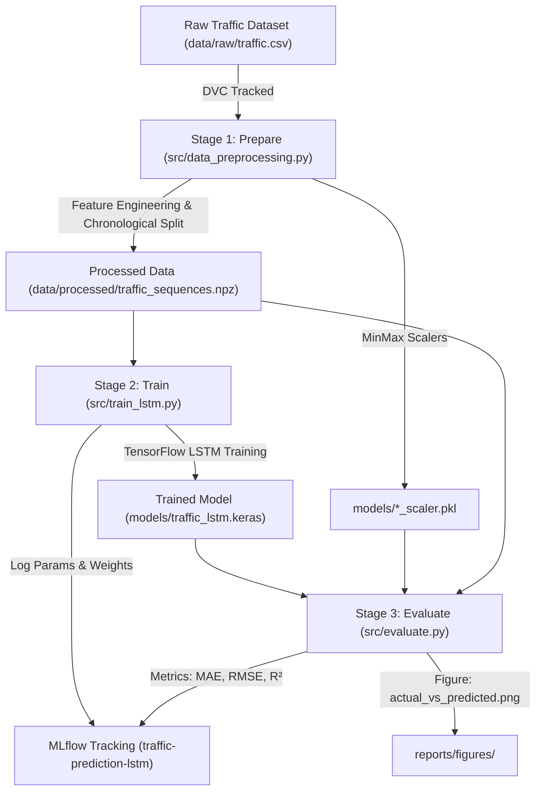

# AI-Based Traffic Prediction System with MLOps

[](https://www.python.org/)
[](https://www.tensorflow.org/)
[](https://mlflow.org/)
[](https://dvc.org/)
[]()

A robust, reproducible, end-to-end Machine Learning Operations (MLOps) pipeline for hourly traffic volume forecasting using Deep Learning (LSTM networks), MLflow experiment tracking, and DVC data versioning.

---

## 📌 Project Overview

Urban traffic congestion results in significant fuel wastage, transit delays, and increased emissions. Accurate short-term traffic volume forecasting allows intelligent transportation systems and municipal authorities to optimize traffic signal timings, manage lane allocations, and route traffic efficiently.

This project implements **Phase 1 (Basic Working Core)** of the Traffic Prediction MLOps lifecycle:
1. **Exploratory Data Analysis (EDA)** with temporal pattern discovery.
2. **Reproducible Data Preprocessing & Feature Engineering** with chronological train/val/test splitting.
3. **Deep Learning (LSTM)** sequence model trained with TensorFlow/Keras.
4. **Experiment Tracking & Artifact Management** with **MLflow**.
5. **Data & Pipeline Versioning** with **DVC (Data Version Control)**.

---

## 🎯 Problem Statement & Objectives

### Problem Statement
Traffic flow exhibits strong non-linearities, daily diurnal cycles (morning and evening rush hours), and weekly periodicity. Traditional static models struggle to capture sequential time-lagged dependencies. A recurrent neural network architecture like **LSTM (Long Short-Term Memory)** is required to capture sequential memory across historical time steps.

### Phase 1 Objectives
- Ingest and version historical traffic time-series data without data leakage.
- Perform chronological sliding-window sequencing with a configurable lookback window ($T=24$ hours).
- Train an LSTM architecture with Adam optimizer and EarlyStopping.
- Evaluate the model rigorously on unseen test sequences using MAE, MSE, RMSE, and $R^2$.
- Track all experiments, hyperparameters, metrics, and models using **MLflow**.
- Build a reproducible 3-stage **DVC** pipeline (`prepare` $\rightarrow$ `train` $\rightarrow$ `evaluate`).

---

## 📊 Dataset Information

- **Dataset Name**: Traffic Prediction Dataset / Metro Traffic Volume Time Series
- **Kaggle Source**: [https://www.kaggle.com/datasets/fedesoriano/traffic-prediction-dataset](https://www.kaggle.com/datasets/fedesoriano/traffic-prediction-dataset)
- **Total Records**: `48,120` rows $\times$ `4` columns
- **Time Range**: `2015-11-01 00:00:00` to `2017-06-30 23:00:00` (Hourly readings)
- **Missing Values**: `0` (clean dataset)
- **Target Column**: `Vehicles` (hourly traffic volume)

### Features Overview
| Column | Type | Description |
| :--- | :--- | :--- |
| `DateTime` | Timestamp | Hourly observation datetime (`YYYY-MM-DD HH:MM:SS`) |
| `Junction` | Integer (1–4) | Identifier of traffic junction monitored |
| `Vehicles` | Integer (1–180) | **Target Variable**: Number of vehicles observed |
| `ID` | Integer | Unique observation identifier |

### Engineered Features
- `Hour` (0 to 23): Captures diurnal rush hour peaks.
- `DayOfWeek` (0 to 6): Captures weekly cycles (Monday through Sunday).
- `Day` (1 to 31): Day of month.
- `Month` (1 to 12): Monthly / seasonal trends.
- `IsWeekend` (0/1): Binary indicator for Saturday/Sunday.

---

## 🏗️ Project Architecture & Pipeline



---

## 🧠 LSTM Neural Network Architecture

The model uses a stacked Long Short-Term Memory (LSTM) network designed for temporal sequence forecasting:

```
Input Layer (Shape: [Batch Size, 24 Steps, 6 Features])
       │
       ▼
LSTM Layer 1 (64 Units, return_sequences=True)
       │
       ▼
Dropout Layer (Rate = 0.20)
       │
       ▼
LSTM Layer 2 (32 Units, return_sequences=False)
       │
       ▼
Dense Layer (16 Units, ReLU activation)
       │
       ▼
Dense Output Layer (1 Unit, Linear activation -> Predicted Traffic Volume)
```

- **Loss Function**: Mean Squared Error (MSE)
- **Optimizer**: Adam ($\text{learning\_rate} = 0.001$)
- **Lookback Horizon**: $24$ time steps (uses the previous 24 hours of traffic & temporal features to predict the 25th hour)
- **Regularization**: Dropout ($p=0.2$) + EarlyStopping monitoring validation loss (patience=5)

---

## 📈 Experimental Results & Metrics

All metrics are evaluated on the **strictly unseen chronological test set** ($N = 7,194$ sequences, April 2017 to June 2017):

| Metric | Measured Value | Interpretation |
| :--- | :--- | :--- |
| **Mean Absolute Error (MAE)** | **6.14 vehicles** | On average, predictions deviate by ~6 vehicles per hour |
| **Root Mean Squared Error (RMSE)** | **8.22 vehicles** | Low penalty on larger peak errors |
| **Mean Squared Error (MSE)** | **67.49** | Squared residual error |
| **Coefficient of Determination ($R^2$)** | **0.9137 (91.37%)** | The LSTM captures **91.4%** of traffic variance |

### Sample Actual vs. Predicted Predictions (Test Set)
| Step Index | Actual Vehicles | Predicted Vehicles | Residual (Pred - Actual) |
| :---: | :---: | :---: | :---: |
| 0 | 12.00 | 13.80 | +1.80 |
| 1 | 6.00 | 6.89 | +0.89 |
| 2 | 35.00 | 47.53 | +12.53 |
| 3 | 15.00 | 13.11 | -1.89 |
| 4 | 7.00 | 10.08 | +3.08 |
| 5 | 7.00 | 4.61 | -2.39 |
| 6 | 34.00 | 35.72 | +1.72 |
| 7 | 14.00 | 11.29 | -2.71 |
| 8 | 9.00 | 7.80 | -1.20 |
| 9 | 4.00 | 3.46 | -0.54 |

---

## 📁 Project Directory Structure

```text
AI-Traffic-Prediction-MLOps/
├── data/
│   ├── raw/
│   │   ├── traffic.csv               # Raw dataset (tracked with DVC)
│   │   ├── traffic.csv.dvc           # DVC pointer file
│   │   └── .gitignore
│   └── processed/
│       ├── processed_traffic.csv     # Cleaned dataframe with engineered features
│       └── traffic_sequences.npz     # Preprocessed 24-step sequence arrays
│
├── notebooks/
│   └── traffic_eda.ipynb             # Interactive Exploratory Data Analysis notebook
│
├── src/
│   ├── inspect_data.py               # Dataset summary and schema validator
│   ├── generate_eda.py               # EDA script saving figures to reports/figures
│   ├── data_preprocessing.py         # Feature engineering, scaling & sliding window
│   ├── train_lstm.py                 # LSTM model training with MLflow tracking
│   └── evaluate.py                   # Metric calculation & actual vs predicted plot
│
├── models/
│   ├── traffic_lstm.keras            # Trained Keras LSTM model
│   ├── feature_scaler.pkl            # Fitted MinMaxScaler for input features
│   └── target_scaler.pkl             # Fitted MinMaxScaler for vehicle target
│
├── mlruns/                           # MLflow experiment runs and artifact storage
│
├── reports/
│   └── figures/
│       ├── traffic_over_time.png     # Trend analysis over 2015-2017
│       ├── traffic_by_hour.png       # Diurnal hourly rush hour profile
│       ├── traffic_by_day_of_week.png# Weekday vs Weekend traffic patterns
│       ├── traffic_by_junction.png   # Traffic volume comparison across 4 junctions
│       └── actual_vs_predicted.png   # 168-hour actual vs predicted test comparison
│
├── requirements.txt                  # Required Python dependencies
├── README.md                         # Complete project documentation and viva guide
├── .gitignore                        # Git ignore configuration
├── dvc.yaml                          # Reproducible DVC pipeline definition
└── dvc.lock                          # DVC pipeline state and hash lockfile
```

---

## ⚙️ Installation & Setup

### 1. Clone or Open Project Directory
```powershell
cd "c:\Users\gowri\OneDrive\Desktop\mlops project"
```

### 2. Create and Activate Virtual Environment
```powershell
py -3.11 -m venv .venv
.\.venv\Scripts\Activate.ps1
```

### 3. Install Dependencies
```powershell
pip install -r requirements.txt
```

### 4. Setup Raw Dataset
Place the raw dataset in `data/raw/traffic.csv` (or extract `archive.zip`).

---

## 🚀 Running the Project

### Option A: Run End-to-End via DVC (Recommended)
DVC ensures all dependencies and stages execute in order:
```powershell
dvc repro
```
To inspect DVC pipeline status:
```powershell
dvc status
```

### 🛠️ Option B: Run Individual Scripts Step-by-Step Individually

> **Note:** First ensure your virtual environment is activated in PowerShell:
> ```powershell
> .\.venv\Scripts\Activate.ps1
> ```
> *(You will see `(.venv)` appear at the beginning of your prompt).*

1. **Step 1 — Data Preprocessing & 24-Hour Sequence Creation:**
   ```powershell
   python src/data_preprocessing.py
   ```
   *Output:* Cleans raw data, extracts time features, creates chronological 70/15/15 splits, scales features, and saves sequence files.

2. **Step 2 — Train the LSTM Model (with MLflow Tracking):**
   ```powershell
   python src/train_lstm.py --epochs 25 --batch_size 64
   ```
   *Output:* Trains the 2-layer LSTM network with EarlyStopping, saves `models/traffic_lstm.keras`, and logs parameters to MLflow.

3. **Step 3 — Evaluate the Model on Unseen Test Data:**
   ```powershell
   python src/evaluate.py
   ```
   *Output:* Computes MAE (6.14), RMSE (8.22), $R^2$ (0.9137), prints actual vs. predicted table, and saves the comparison chart to `reports/figures/actual_vs_predicted.png`.

4. **Optional — Generate EDA Figures:**
   ```powershell
   python src/generate_eda.py
   ```
   *Output:* Generates hourly, daily, and junction traffic distribution plots inside `reports/figures/`.

---

## 🔬 MLflow Experiment Tracking

### How to Start MLflow UI:

1. Open **PowerShell** in the project directory:
   ```powershell
   cd "c:\Users\gowri\OneDrive\Desktop\mlops project"
   ```
2. Activate your virtual environment:
   ```powershell
   .\.venv\Scripts\Activate.ps1
   ```
3. Run the MLflow UI server command:
   ```powershell
   python -m mlflow ui
   ```
   *(or `mlflow ui`)*

4. You will see the server output:
   ```text
   [INFO] Listening at: http://127.0.0.1:5000
   ```
5. Open your browser and navigate to: **[http://127.0.0.1:5000](http://127.0.0.1:5000)**.

---

### Navigating the MLflow Dashboard (For Review / Viva):

1. On the left sidebar, click on the experiment **`traffic-prediction-lstm`**.
2. Click on any recorded run (e.g. `lstm_traffic_run` or `lstm_test_evaluation`) to view:
   - **Hyperparameters**: `sequence_length` (24), `lstm_units_1` (64), `lstm_units_2` (32), `dropout_rate` (0.2), `dense_units` (16), `batch_size` (64), `learning_rate` (0.001), `optimizer` (Adam).
   - **Metrics**: `test_mae` (~5.88–6.14), `test_rmse` (~7.85–8.22), `test_r2` (~0.9137–0.9211), `train_loss_mse`, `val_loss_mse`.
   - **Artifacts**: Download or inspect the saved model weights (`traffic_lstm_model`) and the evaluation comparison plot (`actual_vs_predicted.png`).

---

## 📦 DVC Data & Pipeline Versioning

- **Track Data**:
  ```powershell
  dvc add data/raw/traffic.csv
  ```
- **Pipeline Definition (`dvc.yaml`)**:
  - Stage `prepare`: `data/raw/traffic.csv` $\rightarrow$ `data/processed/traffic_sequences.npz`
  - Stage `train`: `data/processed/traffic_sequences.npz` $\rightarrow$ `models/traffic_lstm.keras`
  - Stage `evaluate`: `models/traffic_lstm.keras` $\rightarrow$ `reports/figures/actual_vs_predicted.png`
- **Reproduce Pipeline**:
  ```powershell
  dvc repro
  ```

---

## 🎓 College Project Viva / Review Q&A Guide

### Q1: What is the core problem being solved?
> **Answer**: We are predicting future hourly traffic volume across road junctions using historical time-series data to assist in intelligent traffic flow management and congestion prevention.

### Q2: What dataset is used and why?
> **Answer**: The Kaggle Traffic Prediction dataset containing 48,120 hourly vehicle count observations across 4 junctions from November 2015 to June 2017.

### Q3: Why choose LSTM over standard regression or feedforward networks?
> **Answer**: Standard feedforward networks assume observations are independent and identically distributed ($i.i.d.$). Traffic data contains strong **temporal autocorrelation**, time-lags, and diurnal rush-hour cycles. LSTM has internal memory cells and gating mechanisms (input, forget, output gates) that retain long-term and short-term dependencies across time steps.

### Q4: Why is random shuffling forbidden in time-series data splitting?
> **Answer**: Random shuffling causes **data leakage** (look-ahead bias) where future time steps leak information into past training sequences. We strictly applied a **chronological split**: first 70% for training (Nov 2015 - Jan 2017), middle 15% for validation (Feb 2017 - Apr 2017), and final 15% for testing (Apr 2017 - Jun 2017).

### Q5: What is DVC and why is it used?
> **Answer**: Git is not designed to version large dataset binaries. DVC (Data Version Control) versions data alongside code using lightweight pointer files (`.dvc`) and establishes a reproducible dependency DAG pipeline (`dvc.yaml` and `dvc.lock`).

### Q6: What is MLflow and why is it used?
> **Answer**: MLflow provides an MLOps platform for experiment tracking, parameter comparison, metric visualization, and model artifact logging across iterations.

### Q7: What metrics were used to evaluate model performance?
> **Answer**:
> - **MAE (6.14 vehicles)**: Average magnitude of absolute error.
> - **RMSE (8.22 vehicles)**: Penalizes large outliers.
> - **$R^2$ Score (0.9137)**: Explains 91.4% of the total variance in test traffic volume.

---

## 📋 Implementation Status & Roadmap

### ✅ CURRENTLY IMPLEMENTED (Phase 1 / Review-1):
- [x] Kaggle Traffic time-series dataset ingestion and inspection
- [x] Exploratory Data Analysis notebook (`notebooks/traffic_eda.ipynb`) and report figures
- [x] Chronological train/val/test data preprocessing & 24-step sliding window sequencing
- [x] LSTM Neural Network with TensorFlow/Keras & EarlyStopping
- [x] Model evaluation with MAE, MSE, RMSE, $R^2$ and comparison visualization
- [x] MLflow experiment tracking (params, metrics, artifacts)
- [x] DVC dataset versioning and reproducible 3-stage pipeline (`dvc.yaml`)

### 🔮 FUTURE WORK (Phase 2 / Review-2):
- [ ] **FastAPI**: REST API for real-time inference endpoints.
- [ ] **Streamlit**: Interactive user dashboard for traffic volume visualization.
- [ ] **Docker**: Containerization for reproducible microservice deployment.
- [ ] **Evidently AI**: Data drift and model performance degradation monitoring.
- [ ] **Automated CI/CD & Retraining**: Scheduled model retraining pipeline.
