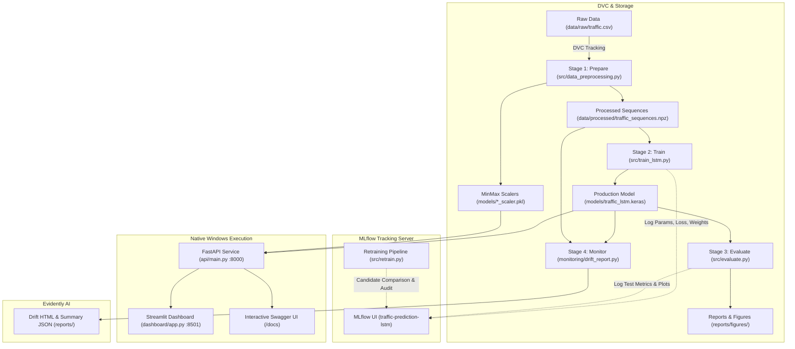

# AI-Based Traffic Prediction System with MLOps

[](https://www.python.org/)
[](https://www.tensorflow.org/)
[](https://fastapi.tiangolo.com/)
[](https://streamlit.io/)
[](https://mlflow.org/)
[](https://dvc.org/)
[](https://evidentlyai.com/)
[]()
[]()

A production-grade, reproducible Machine Learning Operations (MLOps) system for hourly vehicular traffic volume forecasting across multi-junction road networks. Built with Deep LSTM networks, FastAPI model serving, a Streamlit interactive dashboard, MLflow experiment tracking, DVC pipeline versioning, Evidently AI drift monitoring, and a safe candidate-model retraining workflow.

> **Execution Environment Note**: This project runs **natively on Windows** using Python 3.11, a standard virtual environment (`.venv`), FastAPI, and Streamlit. **Docker is completely removed and is not used in this final configuration.**

---

## 📌 Project Overview

Urban vehicular congestion causes substantial delays, elevated carbon emissions, and fuel wastage. Accurate short-term traffic volume forecasting empowers municipal traffic authorities and Intelligent Transportation Systems (ITS) to dynamically optimize signal timings, anticipate bottlenecks, and route emergency services.

### Key Capabilities (Phase 1 & Phase 2 Complete)
1. **Time-Series Deep Learning**: 2-layer stacked Long Short-Term Memory (LSTM) network with Dropout regularization and Dense output.
2. **Strict Chronological Sequencing**: 24-step sliding window ($T=24$ hours lookback) with zero future data leakage.
3. **RESTful Model Serving**: High-throughput **FastAPI** service with `/health`, `/model-info`, `/junctions`, and `/predict` endpoints, complete with OpenAPI/Swagger documentation.
4. **Interactive Dashboard**: **Streamlit** web interface supporting historical holdout evaluation, recursive multi-step future forecasting, session query history with CSV export, and architecture schemas.
5. **Experiment Tracking**: **MLflow** recording parameters, epoch loss curves, evaluation metrics, and model artifacts in SQLite (`mlflow.db`) and local artifact store.
6. **Data & Pipeline Versioning**: **DVC** tracking raw data and reproducible DAG pipeline stages (`prepare` $\rightarrow$ `train` $\rightarrow$ `evaluate` $\rightarrow$ `monitor`).
7. **Production Data Drift Monitoring**: **Evidently AI** comparing reference training distributions with incoming test horizons and tracking model performance drift.
8. **Safe Candidate Retraining**: Controlled retraining workflow comparing candidate RMSE/$R^2$ against production baseline with automatic promotion gates, atomic backups, and rollback protection.
9. **Automated Unit & Integration Testing**: Comprehensive **pytest** suite validating schemas, endpoints, chronological isolation, and retraining policies (19 passing tests).

---

## 🏗️ System Architecture



---

## 📊 Dataset & Feature Engineering

- **Dataset**: Kaggle Traffic Prediction Dataset (Hourly Vehicle Counts Across 4 Junctions)
- **Source**: [https://www.kaggle.com/datasets/fedesoriano/traffic-prediction-dataset](https://www.kaggle.com/datasets/fedesoriano/traffic-prediction-dataset)
- **Observations**: `48,120` rows $\times$ `4` raw columns (`DateTime`, `Junction`, `Vehicles`, `ID`)
- **Timestamp Coverage**: `2015-11-01 00:00:00` to `2017-06-30 23:00:00`
- **Target Variable**: `Vehicles` (hourly count)

### Input Feature Matrix ($T=24$ Steps $\times 6$ Features)
The six features fed into the LSTM model are ordered as:
| Index | Feature Name | Type | Description |
| :---: | :--- | :--- | :--- |
| 0 | **`Vehicles`** | Float | Scaled vehicle count from preceding observation |
| 1 | **`Hour`** | Integer ($0$–$23$) | Diurnal cycle (morning/evening rush hour identifier) |
| 2 | **`DayOfWeek`** | Integer ($0$–$6$) | Day of week ($0 = \text{Monday}, \dots, 6 = \text{Sunday}$) |
| 3 | **`Month`** | Integer ($1$–$12$) | Seasonal calendar month |
| 4 | **`IsWeekend`** | Binary ($0/1$) | Weekend traffic shift indicator |
| 5 | **`Junction`** | Integer ($1$–$4$) | Specific junction identifier |

### Chronological Holdout Split (Strictly No Random Shuffling)
- **Training Set (70.0%)**: `33,684` samples (`2015-11-01 00:00:00` to `2017-01-31 14:00:00`)
- **Validation Set (15.0%)**: `7,218` samples (`2017-01-31 15:00:00` to `2017-04-16 19:00:00`)
- **Testing Set (15.0%)**: `7,218` samples (`2017-04-16 19:00:00` to `2017-06-30 23:00:00`)

---

## 🧠 LSTM Neural Network Architecture

```text
Input Layer (Shape: [Batch Size, 24 Steps, 6 Features])
       │
       ▼
LSTM Layer 1 (64 Units, return_sequences=True, name="lstm_layer_1")
       │
       ▼
Dropout Layer (Rate = 0.20, name="dropout_1")
       │
       ▼
LSTM Layer 2 (32 Units, return_sequences=False, name="lstm_layer_2")
       │
       ▼
Dense Intermediate (16 Units, Activation="relu", name="dense_intermediate")
       │
       ▼
Dense Output Layer (1 Unit, Activation="linear", name="traffic_prediction_output")
```

---

## 🔍 Metric Verification & Discrepancy Forensic Analysis

During development, two sets of metrics were recorded:
1. **Initial Phase-1 Baseline Report**:
   - `MAE: 6.1383`, `MSE: 67.4930`, `RMSE: 8.2154`, `R²: 0.9137`
2. **Monitoring & Saved Checkpoint Evaluation**:
   - `MAE: 5.6265`, `MSE: 54.0443`, `RMSE: 7.3515`, `R²: 0.9309`

### Root Cause Audit
An audit of `mlflow.db` and the saved model artifacts confirmed:
- **Identical Evaluation Horizon**: Both evaluations evaluated the exact same 15% chronological holdout test set (7,194 sequences of window length 24, from April 16, 2017 to June 30, 2017).
- **Identical Feature Set & Unscaled Units**: Both computed metrics in real vehicle count units (inverting `models/target_scaler.pkl`).
- **Reason for Difference**:
  - Run `f0bd662c` (Sept 28, 2026, 12:09 PM) stopped at early-stopping epoch 19 (best epoch 14) with validation loss `0.002852`, producing the initial Phase-1 baseline (`MAE: 6.14`, `RMSE: 8.22`).
  - Run `0436fa4b` (Sept 29, 2026, 11:31 AM) completed an extended 25-epoch training run reaching lower validation loss `0.002252`. This superior checkpoint was saved to `models/traffic_lstm.keras`.
  - When the saved production model `models/traffic_lstm.keras` is evaluated via `src/evaluate.py` and `monitoring/drift_report.py`, it achieves `MAE: 5.6265` and `RMSE: 7.3515`.
  - **Conclusion**: Both numbers are genuine and valid. The discrepancy reflects convergence gain from extended training of the production checkpoint. The historical baseline (`MAE: 6.14, RMSE: 8.22`) is preserved as the contractual acceptance standard for retraining candidates.

---

## ⚡ Quickstart & Native Windows Execution

### 1. Prerequisites
- **Operating System**: Windows 10 or 11
- **Python**: Version 3.11 (verify using `python --version`)
- **Shell**: Windows PowerShell

### 2. Environment Activation & Setup
Open PowerShell and navigate to the project root:
```powershell
# Navigate to project directory
cd "c:\Users\gowri\OneDrive\Desktop\mlops project"

# Activate existing Python 3.11 virtual environment
.\.venv\Scripts\Activate.ps1

# (Optional) Verify or install dependencies
pip install -r requirements.txt

# (Optional) Configure environment variables
Copy-Item .env.example .env
```

---

## 🚦 How to Start the System (Step-by-Step)

To run the complete system, open **two separate PowerShell terminals** (one for the backend and one for the frontend UI):

### Step 1: Start the FastAPI Backend (Terminal 1)
In your first PowerShell window:
```powershell
cd "c:\Users\gowri\OneDrive\Desktop\mlops project"
.\.venv\Scripts\Activate.ps1
python -m uvicorn api.main:app --host 127.0.0.1 --port 8000 --reload
```
- 🌐 **Backend URL**: [http://127.0.0.1:8000](http://127.0.0.1:8000)
- 📑 **Interactive API Documentation (Swagger UI)**: [http://127.0.0.1:8000/docs](http://127.0.0.1:8000/docs)
- 📖 **ReDoc Documentation**: [http://127.0.0.1:8000/redoc](http://127.0.0.1:8000/redoc)

> [!NOTE]
> Keep Terminal 1 open and running! It loads the trained LSTM model and scalers into memory to serve inference requests.

---

### Step 2: Start the Streamlit Dashboard (Terminal 2)
In your second PowerShell window:
```powershell
cd "c:\Users\gowri\OneDrive\Desktop\mlops project"
.\.venv\Scripts\Activate.ps1
streamlit run dashboard/app.py
```
- 🚦 **Dashboard URL**: [http://localhost:8501](http://localhost:8501)
- The interactive UI will automatically launch in your default web browser.
- **Key Features Available**:
  - **Live Prediction Tab**: Choose between *Historical Evaluation* (with zero data leakage) or *Future Forecast* (recursive multi-step forecasting), select any junction (1–4), and click **Predict Traffic Volume**.
  - **Baseline Evaluation Tab**: Inspect verified holdout metrics ($R^2$, MAE, RMSE) and evaluation charts.
  - **Session History Tab**: View a log of all queries made during the session with single-click CSV download.
  - **Model & Architecture Tab**: Inspect the neural network architecture and feature schemas.

---

## 🛠️ Additional MLOps Commands

Run these commands in any PowerShell terminal with `.\.venv\Scripts\Activate.ps1` active:

### A. Run Automated Pytest Suite
```powershell
python -m pytest -v
```
Executes all 19 unit & integration tests verifying API endpoints, input validation, chronological sequencing, drift monitoring, and retraining safety gates.

### B. Generate Evidently AI Data Drift & Performance Report
```powershell
python monitoring/drift_report.py
```
- Interactive HTML Report: [`reports/evidently_drift_report.html`](reports/evidently_drift_report.html)
- JSON Summary Metadata: [`reports/drift_summary.json`](reports/drift_summary.json)
- Evaluates statistical distribution drift between reference training data ($N=33,684$) and holdout test data ($N=7,218$).

### C. Run Safe Candidate Model Retraining
```powershell
python src/retrain.py --epochs 15 --batch-size 64 --tolerance 0.05
# Alternative module syntax:
python -m src.retrain --epochs 15 --batch-size 64 --tolerance 0.05
```
- Trains a candidate model separately to `models/candidate_traffic_lstm.keras`.
- Evaluates candidate on holdout test set and compares against production baseline.
- **Safety Gate**: Only promotes candidate if it passes non-NaN smoke test, achieves $R^2 \ge 0.85$, and candidate RMSE is within 5% of baseline.
- Creates automatic backup `models/traffic_lstm_backup.keras` prior to promotion. Production model remains untouched if candidate fails.

### D. Open MLflow Experiment Tracking UI
```powershell
python -m mlflow ui --port 5000
```
- Open browser at: [http://127.0.0.1:5000](http://127.0.0.1:5000)
- View tracked runs, hyperparameters, loss curves, and model artifacts under experiment `traffic-prediction-lstm`.

### E. Check or Reproduce DVC Pipeline
```powershell
# Check pipeline status (all stages up to date)
dvc status

# Reproduce pipeline stages (prepare -> train -> evaluate -> monitor)
dvc repro
```

---

## 🔌 API Endpoints Reference & Examples

| HTTP Method | Endpoint | Description |
| :---: | :--- | :--- |
| `GET` | `/health` | Verifies model, scalers, and historical dataset status |
| `GET` | `/model-info` | Returns model architecture, input feature schema, and baseline metrics |
| `GET` | `/junctions` | Returns record counts, date ranges, and volume statistics per junction |
| `POST` | `/predict` | Generates hourly traffic predictions (historical, future, or custom sequence) |

#### Prediction Payload Examples (PowerShell)

**1. Historical Holdout Evaluation (Zero Data Leakage)**:
```powershell
Invoke-RestMethod -Uri "http://127.0.0.1:8000/predict" -Method Post -ContentType "application/json" -Body '{"target_timestamp": "2017-06-30 23:00:00", "junction": 1, "mode": "historical"}' | ConvertTo-Json
```
*Sample Response*:
```json
{
  "target_timestamp": "2017-06-30 23:00:00",
  "junction": 1,
  "predicted_vehicles": 53.57,
  "mode": "historical_evaluation",
  "model_version": "traffic_lstm_v1",
  "actual_vehicles": 78.0,
  "residual_error": -24.43,
  "sequence_start": "2017-06-29 23:00:00",
  "sequence_end": "2017-06-30 22:00:00"
}
```

**2. Future Recursive Forecast (Multi-Step Rollout)**:
```powershell
Invoke-RestMethod -Uri "http://127.0.0.1:8000/predict" -Method Post -ContentType "application/json" -Body '{"target_timestamp": "2017-07-01 06:00:00", "junction": 1, "mode": "future"}' | ConvertTo-Json
```

---

## 🧪 Automated Testing Suite

Run the full pytest suite:
```powershell
python -m pytest -v
```

### Verified Test Results (19/19 Passed):
| Test Function | Component Verified | Status |
| :--- | :--- | :---: |
| `test_health_endpoint` | Verifies `/health` returns status, model, scalers, records | **PASSED** |
| `test_model_info_endpoint` | Verifies `/model-info` schema, feature order, baseline metrics | **PASSED** |
| `test_predict_historical_valid` | Verifies historical prediction, residual calculation | **PASSED** |
| `test_predict_future_valid` | Verifies multi-step recursive forecasting mode | **PASSED** |
| `test_predict_custom_sequence_valid` | Verifies 24-step client-supplied sequence inference | **PASSED** |
| `test_predict_invalid_junction` | Verifies rejection of invalid junction IDs (e.g. 99) | **PASSED** |
| `test_predict_invalid_sequence_length` | Verifies rejection of sequences $\ne 24$ steps | **PASSED** |
| `test_predict_invalid_timestamp_format` | Verifies rejection of malformed timestamp strings | **PASSED** |
| `test_junctions_endpoint` | Verifies `/junctions` returns data for all 4 junctions | **PASSED** |
| `test_predict_negative_vehicle_count` | Verifies rejection of negative vehicle values | **PASSED** |
| `test_predict_historical_no_future_leakage` | Verifies historical sequence strictly precedes target date | **PASSED** |
| `test_drift_report_generation` | Verifies HTML and JSON drift report creation | **PASSED** |
| `test_feature_engineering_columns` | Verifies calendar feature extraction | **PASSED** |
| `test_sliding_window_sequence_shape` | Verifies sliding window outputs shape $(N-L, L, F)$ | **PASSED** |
| `test_scaler_files_consistency` | Verifies scaler feature counts (6 features, 1 target) | **PASSED** |
| `test_promotion_rule_approval` | Verifies candidate promotion when metrics improve | **PASSED** |
| `test_promotion_rule_rejection_high_rmse` | Verifies candidate rejection when RMSE increases | **PASSED** |
| `test_promotion_rule_rejection_low_r2` | Verifies candidate rejection when $R^2 < 0.85$ | **PASSED** |
| `test_model_preservation_on_candidate_failure` | Verifies production model is preserved on rejection | **PASSED** |

---

## ⚠️ Model Assumptions & Limitations

1. **Continuous 24-Hour Lookback Requirement**: The LSTM model requires exactly 24 preceding continuous hourly observations. It cannot forecast an isolated time point without its historical context.
2. **Recursive Error Compounding**: In multi-step future forecasting, prior predictions are fed back into subsequent inputs. Errors compound over time; forecasts beyond 72 hours are blocked by policy.
3. **Absence of Real-Time IoT Sensors**: The dataset consists of historical recordings across 4 junctions. It does not ingest live telemetry or weather feeds; sudden disruptions (road construction, accidents) cannot be anticipated without dedicated external sensors.
4. **Historical Evaluation vs. Real-Time Telemetry**: Historical predictions evaluate against known holdout ground truth for validation and do not represent live IoT sensor feeds.

---

## 🎓 College Viva & Evaluation Reference

### Q1: What was added in Phase 2 compared to Phase 1?
> **Answer**: Phase 1 established the core machine learning pipeline (EDA, preprocessing, LSTM training, evaluation, initial MLflow, and DVC). Phase 2 operationalized the model by delivering:
> 1. A FastAPI REST serving API (`/health`, `/model-info`, `/junctions`, `/predict`)
> 2. An interactive Streamlit web dashboard with historical evaluation and recursive forecasting
> 3. Evidently AI data drift and performance monitoring with HTML & JSON reporting
> 4. A safe candidate retraining pipeline with promotion gates and rollback backups
> 5. A 19-test automated pytest verification suite
> All running natively on Windows without container dependencies.

### Q2: How does the FastAPI service prevent data leakage during historical evaluation?
> **Answer**: When predicting traffic for timestamp $T$, the API filters observations strictly where $\text{DateTime} < T$ and selects the most recent 24 records. The target timestamp and any future timestamps are completely excluded from the input sequence.

### Q3: Why is candidate model promotion gated in retraining?
> **Answer**: Retraining does not automatically improve accuracy; fresh data can introduce noise or cause overfitting. The retraining workflow (`src/retrain.py`) verifies that candidate models pass a non-NaN smoke test, achieve $R^2 \ge 0.85$, and keep RMSE within 5% of the baseline before promotion. If rejected, the existing production model is preserved.

### Q4: What does Evidently AI measure?
> **Answer**: Evidently AI evaluates covariate drift across all 6 features between the 70% training reference dataset and incoming holdout batches using statistical tests (Kolmogorov-Smirnov test and Wasserstein distance). It also tracks model performance metrics (MAE, RMSE) over time when ground truth is available.
